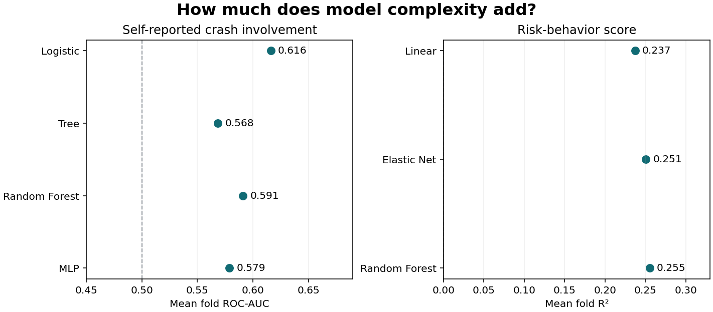

# Machine Learning for Human Behavior: Comparing Models in Road Safety

**Do more complex models improve performance on road-safety research data?** This project compares regression baselines with regularized, tree-based and neural-network models under shared cross-validation splits. The two tasks are estimating a self-reported risky-driving score and classifying retrospective reports of crash involvement. **More complex models showed no clear advantage over the linear baselines in this sample.**

## Data and measures

The analysis uses a restricted road-safety research dataset with 792 participant records. Personality was measured with the Personality Inventory for DSM-5 (PID-5), originally developed by Krueger et al. (2012). Sánchez, Montes, and colleagues (2023) later reported on a shortened and modified version for use in Argentina.

## Models compared and results

### 1. Self-reported crash involvement (binary classification)

- **Outcome.** Retrospective self-report of crash involvement, coded yes or no in the source study (135 yes responses among 792 participants).
- **Predictors.** Five PID-5 personality domains, five driving-style scores and five specific behaviors: speeding, driving after drinking, distracted driving, phone use and driving while tired.

| Model | ROC-AUC (mean ± SD) | Average precision (mean ± SD) |
|---|---:|---:|
| Logistic regression | .616 ± .065 | .268 ± .064 |
| Decision tree | .568 ± .029 | .205 ± .012 |
| Random Forest | .591 ± .049 | .240 ± .043 |
| Neural network (multilayer perceptron) | .579 ± .029 | .235 ± .035 |

Discrimination was modest. Logistic regression had the highest observed mean ROC-AUC and average precision in five-fold cross-validation. These are descriptive differences from internal validation in a previously explored sample. Crash involvement was reported retrospectively. Predictors and outcomes share a self-report method, which may affect the estimated relationships. The models classify past reports and are intended for research and portfolio demonstration. Individual risk assessment and selection are outside their scope.

**How to read AP.** Average precision summarizes how well a model ranks participants with self-reported crash involvement near the top across classification thresholds. It ranges from 0 to 1, with 1 indicating perfect ranking. A constant score gives an AP equal to the positive-class prevalence, about .170 here. The observed values (.205–.268) show modest gains over that reference.

#### How to read the decision tree

For the illustrated tree, a stratified 70/30 split assigned 554 participants to training and 238 to testing. Imputation and tree fitting used the training data. Its ROC-AUC on the held-out test was .566.

Disinhibition was the first split. The tree then used dissociative driving style for one subgroup and risky driving style for the other. These branches show how this particular fit combined personality and driving-style information to classify crash history.

[Decision tree](figures/decision-tree.png) · [Pearson correlations between driving styles and PID-5 domains](figures/correlation-heatmap.png)

### 2. Risky-driving score (regression)

- **Outcome.** A quantitative score summing 12 self-reported risky driving behaviors, each rated from 1 to 5. The total ranges from 12 to 60 and was observed for 777 participants. The models treat the total as continuous. The 15 participants with missing totals were excluded from regression.
- **Predictors.** The table shows models using the 25 PID-5 personality facets. The companion results also report the same models using the five domains as an alternative predictor set.

| Model | R² (mean ± SD) | MAE in score points (mean ± SD) |
|---|---:|---:|
| Linear regression | .237 ± .092 | 4.86 ± 0.11 |
| Elastic Net | .251 ± .085 | 4.82 ± 0.09 |
| Random Forest | .255 ± .068 | 4.76 ± 0.07 |

The forest reduced mean absolute error by about 0.10 score points relative to ordinary linear regression. The mean-only reference had an error of 5.71 points. R² and error refer to predictions of the total score.

## Which predictors contributed most?

For **self-reported crash involvement**, the logistic regression's mean ROC-AUC decreased most when distracted driving was shuffled (**.047**), followed by risky driving style (**.023**) and the PID-5 domain antagonism (**.022**). The model used personality domains, driving styles and specific driving behaviors.

For the **total risky-driving score**, the Random Forest used the 25 PID-5 facets. Shuffling risk taking (`desiar`), deceitfulness (`anteng`) and distractibility (`desidis`) increased mean absolute error by **0.30**, **0.20** and **0.16** score points, respectively. For these three facets, the average effect was positive in all five folds.

These exploratory estimates average 12 permutations per predictor on each of the five held-out folds. Correlated predictors can share or substitute for information, so each value reflects the fitted model's reliance on that predictor in the presence of the others.

[Crash predictor importance](results/crash-importance.csv) · [Risky-driving facet importance](results/risk-importance.csv)

## Evaluation and reproducibility

Each task uses five shared folds, stratified for classification. Mean imputation and scaling, where applicable, are fitted inside the training folds. Hyperparameters were fixed for this comparison, with a mix of defaults and explicitly chosen settings. The comparison used the settings in the analysis script without hyperparameter search. The random seed was 42. The classification output also includes Brier score and balanced accuracy at a threshold of 0.5. The tables report mean ± standard deviation across folds. The standard deviations summarize variation across splits. The differences between model means remain descriptive.

Internal cross-validation estimates performance on held-out subsets of the same study sample. External validation would test the models on an independent dataset and was beyond the scope of this analysis.

    python -m pip install -r requirements.txt
    export TRANSITO_CSV_PATH=/path/outside/this/project/authorized.csv
    python analysis.py

The participant data stay in restricted access. The project includes code and aggregate results only. The script regenerates the figures and all tables.

[Classification metrics](results/classification-summary.csv) · [70/30 tree test](results/tree-holdout.csv) · [Regression metrics](results/regression-summary.csv)

## References

Krueger, R. F., Derringer, J., Markon, K. E., Watson, D., & Skodol, A. E. (2012). Initial construction of a maladaptive personality trait model and inventory for DSM-5. *Psychological Medicine, 42*(9), 1879–1890. https://doi.org/10.1017/S0033291711002674

Sánchez, R. O., Montes, S. A., Galarza, A. L., Somerstein, L. D., & Gainza, M. D. (2023). Una versión reducida y modificada del Inventario de Personalidad para el DSM-5 (PID-5) en la Argentina. *Interdisciplinaria, 40*(1), 115–136. https://doi.org/10.16888/interd.2023.40.1.7
